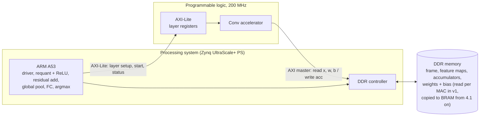
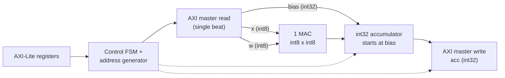
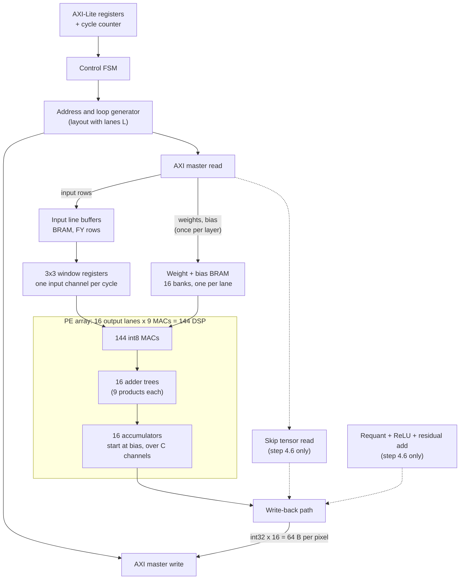
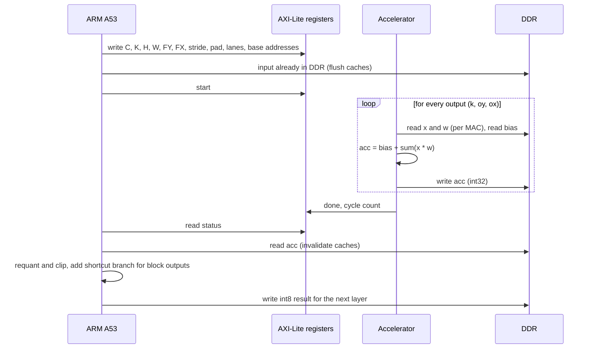
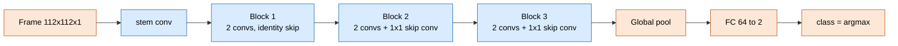

# Accelerator architecture diagrams

Rough block diagrams for `architecture-spec.md`. Mermaid; renders in VS Code (Markdown preview with a Mermaid extension), GitHub and most Markdown viewers. Block names are not final.

## 1. System

## 2. v1: naive accelerator (1 MAC, no buffering)

## 3. Target architecture (after steps 4.1 to 4.4)

Dotted blocks are added by Fusion (4.6). Weights are loaded once per layer or network (open point 2 in the spec); everything else streams per output pixel.

## 4. One conv layer, v1

## 5. Who does what per network stage (v1)

Blue: convolutions run in the PL. Orange: ARM. The ARM also does requant, ReLU and the residual add between convs (until 4.6).
