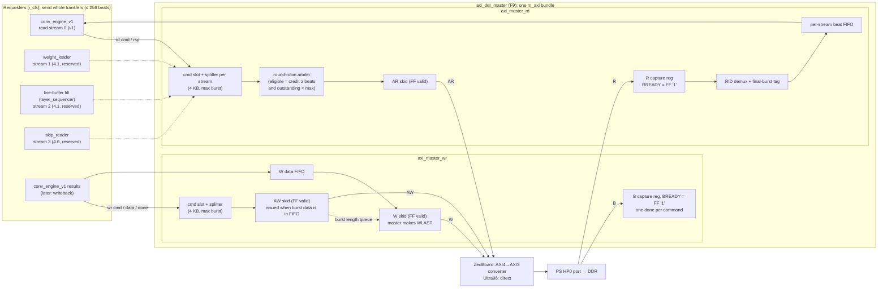

# Feature: AXI4 burst master between the accelerator and DDR

Status: **implemented and verified in simulation** (2026-11-09), all phases AXI-P1 to AXI-P6 ([plan progress](../../.gateflow/plans/axi-ddr-master.md#progress), results in [section 3.3](#33-verified-so-far)). Open: the board run (TD-1, TD-2), TD-3, and the flip of the repo's `BOARD` from `ULTRA96` to `ZEDBOARD`, which waits for the `camus_pkg` owner ([Q8](#14-open-questions)). This file holds the scope of the feature: anything not listed under [In scope](#in-scope) belongs to another task. The implementation plan is [`.gateflow/plans/axi-ddr-master.md`](../../.gateflow/plans/axi-ddr-master.md).

This feature is the **data link** from [`axi-interfaces.md` section 1](axi-interfaces.md#L5): accelerator to DDR, full AXI4 with bursts, with the accelerator as master. It delivers:
- deliverable row **L4**: masters plus a simulation memory model ([`deliverable-11-11.md:67`](../deliverable-11-11.md#L67));
- the **master part of [task 2.3](vhdl-accelerator-tasks.md#L74)**.

Everything between the CPU and the accelerator is outside it.

## Decisions log

| Date | Topic | Decision |
|---|---|---|
| 2026-11-09 | Board | **ZedBoard now; Ultra96 later and for good.** <br>- Built for the ZedBoard: 64-bit HP port, AXI3 limits. <br>- Switching to the Ultra96 is one line ([section 3.2](#32-switching-to-the-ultra96)). |
| 2026-11-09 | 4 KB rule | **The master splits** (revised the same day; the first choice was "requesters split"). <br>- Requesters send up to 256 beats at any beat-aligned address and never need the rule. <br>- The master cuts every command at 4 KB and at the board's burst limit ([section 9](#9-burst-splitting-rule-inside-the-master)). <br>- This replaces [`vhdl-modules.md:201`](vhdl-modules.md#L201). |
| 2026-11-09 | Soft reset with bursts in flight | Direction: **drain in the master**. Deferred as technical debt [TD-3](#td-3-soft-reset-while-a-burst-is-in-flight). |
| 2026-11-09 | Scope | Accelerator ↔ DDR over full AXI4 only. The CPU ↔ accelerator side is outside. |
| 2026-11-09 | HP vs HPC | **Under discussion** ([section 4](#4-port-choice-hp-vs-hpc-under-discussion)). Interim choice: HP. |
| 2026-11-09 | Real port latency, second HP port | Technical debt [TD-1](#td-1-real-read-latency-of-the-port) and [TD-2](#td-2-second-hp-port). |
| 2026-11-09 | Final review | **Two independent reviews**: <br>- docs against the project docs: the design is consistent; <br>- plan against the RTL: no deadlock, no missed `done`, and every engine port maps. <br>All findings are fixed in this revision. The `camus_pkg` change passes the whole existing TB regression on both boards ([section 3.3](#33-verified-so-far)). |

---

## 1. Scope

### In scope

| # | Deliverable | File |
|---|---|---|
| F1 | **Platform switch:** a `BOARD` constant in `camus_pkg`, with `AXI_DATA_W` derived from it | [`vhdl/src/camus_pkg.vhd`](../../vhdl/src/camus_pkg.vhd#L7) (changed; owner's sign-off needed) |
| F2 | `axi_pkg`: per-board AXI limits; AXI constants; `burst_beats()`, the split rule used inside both masters; `crosses_4k()` for checks; `clog2()` | `vhdl/src/axi_pkg.vhd` (packages go in `vhdl/src/`, [`vhdl-modules.md:18`](vhdl-modules.md#L18)) |
| F3 | `axi_skid`: register slice, so every handshake signal on `m_axi_*` comes straight from a flip-flop | `vhdl/src/interface/axi_skid.vhd` |
| F4 | `sync_fifo`: synchronous FIFO, first-word-fall-through, registered output, with a defined timing contract | `vhdl/src/interface/sync_fifo.vhd` |
| F5 | `axi_master_rd`: several read streams, one ARID per stream, a burst splitter per stream, several bursts in flight | `vhdl/src/interface/axi_master_rd.vhd` |
| F6 | `axi_master_wr`: a burst splitter, several bursts in flight, one `done` per command | `vhdl/src/interface/axi_master_wr.vhd` |
| F7 | `axi_mem_model`: simulation-only AXI4 slave, with: <br>- random latency and back-pressure; <br>- out-of-order returns across IDs; <br>- switchable error injection; <br>- protocol and burst-length checks; <br>- 4 regions of configurable size; <br>- backdoor preload and dump. | `vhdl/tests/models/axi_mem_model.vhd` |
| F8 | Unit TBs for F2–F7, plus one integration TB: `conv_engine_v1` → `axi_ddr_master` → `axi_mem_model`. The integration TB also covers F9, which is structural only. | `vhdl/tests/unit/interface/`, `vhdl/tests/integration/` |
| F9 | `axi_ddr_master`: a structural wrapper that joins both masters into **one `m_axi` bundle** with one ID width. The top level ([task 2.3](vhdl-accelerator-tasks.md#L74)) instantiates this one block. | `vhdl/src/interface/axi_ddr_master.vhd` |

### Out of scope (other tasks, do not touch here)

- **The CPU ↔ accelerator side:**
  - the AXI-Lite control link (`axi_lite_regs`), including where a soft-reset pulse comes from;
  - the ARM driver, cache maintenance and buffer allocation.
- **`conv_accel_top`** ([task 2.3](vhdl-accelerator-tasks.md#L74), [`vhdl-modules.md:105`](vhdl-modules.md#L105)). It instantiates `axi_ddr_master` (F9); building the top itself is not part of this feature.
- **Changing `conv_engine_v1`** so that it keeps more than one read in flight. The master supports it, but the engine change is its own task.
- **The future requesters** of [step 4.1](vhdl-accelerator-tasks.md#L93) and [step 4.6](vhdl-accelerator-tasks.md#L98):
  - who they are: [`weight_loader`](vhdl-modules.md#L296), the line-buffer fill driven by [`layer_sequencer`](vhdl-modules.md#L391), and [`skip_reader`](vhdl-modules.md#L458);
  - what they do here: send whole transfers of up to 256 beats, which the master splits, and get a stream slot.
  - **ZedBoard note for them:** a 16-channel int8 pixel is 2 beats at 64 bit. Their pixel-wide ports ([`vhdl-modules.md:323`](vhdl-modules.md#L323), [`:470`](vhdl-modules.md#L470)) then need a 2-beat-to-pixel packer on their side.
- **The Vivado block design** ([task 3.3](vhdl-accelerator-tasks.md#L82)), apart from the HP port facts in [section 3](#3-platforms).
- **Any Xilinx AXI DMA IP.** [D3](vhdl-accelerator-tasks.md#L38) chose a custom master.

---

## 2. Requirements

These are the notes from the meeting, written as rules.

| ID | Rule | How the design meets it |
|---|---|---|
| R1 | **One handshake per channel.** AR, R, AW, W and B each have their own valid/ready handshake. No channel waits for another channel's handshake. | AW and W are separate paths, and W beats may go out one or more cycles after AW. (`axi_lite_regs` is different: it waits for AWVALID and WVALID together.) |
| R2 | **Valid and ready must come from flip-flops.** No combinational logic between a register and an `m_axi_*` handshake output. | ARVALID, AWVALID and WVALID come from the output register of `axi_skid` (F3). RREADY and BREADY are flip-flops held at 1 after reset; R7 makes this safe. |
| R3 | **Bursts** to fetch data fast. | INCR bursts at full bus width: AxBURST = `01`, AxSIZE = log2(data width / 8), AxLEN = beats − 1. At most 16 beats on the ZedBoard (AXI3). |
| R4 | **No burst crosses a 4 KB page** (AXI rule: one page is one address mapping). | **The master splits** every command with `axi_pkg.burst_beats()`, at each 4 KB boundary and at `G_MAX_BURST`. Requesters never need to know the rule. `axi_mem_model` checks every burst on the bus. |
| R5 | **Transaction IDs** for out-of-order returns. | One ARID per read **stream**. R beats are routed by RID into per-stream FIFOs ([section 6](#6-read-path-axi_master_rd)). |
| R6 | **Fast ports** for data. | `m_axi` goes to a PS high-performance port, not a general-purpose port: `S_AXI_HP0` on the ZedBoard, `S_AXI_HP0_FPD` on the Ultra96. |
| R7 | *(derived)* The master never back-pressures R or B. | Credits: a read burst is issued only if its stream FIFO has room for all its beats. B needs only a counter. |
| R8 | *(derived)* AXI reset rules. | Synchronous active-high `i_rst`, the house rule ([`vhdl-modules.md:9`](vhdl-modules.md#L9)). All valid flip-flops reset to 0. The top inverts `aresetn` once ([`axi-interfaces.md:59`](axi-interfaces.md#L59)). |

---

## 3. Platforms

- **Now:** the ZedBoard ([`board-session.md:3`](../board-session.md#L3), [`deliverable-11-11.md:7`](../deliverable-11-11.md#L7)).
- **Later, and for good:** the Ultra96.
- **Older plan docs:** they assume the Ultra96 ([`architecture-spec.md:9`](architecture-spec.md#L9), [`axi-interfaces.md:3`](axi-interfaces.md#L3)). [Section 14](#14-open-questions) lists the lines to update.

### 3.1 Profiles

Facts marked *(check)* are from memory. Confirm them in Vivado and in UG585 (Zynq-7000) or UG1085 (Zynq UltraScale+).

| | **ZedBoard (now, default)** | Ultra96 (later, for good) |
|---|---|---|
| PS | Zynq-7000 XC7Z020, 2 × Cortex-A9 | Zynq UltraScale+ MPSoC ZU3EG, 4 × Cortex-A53 |
| DDR | 512 MB DDR3, 32 bit *(check)* | 2 GB LPDDR4, 32 bit ([`performance-model.md:31`](performance-model.md#L31)) |
| Data port | `S_AXI_HP0` (HP0..HP3) | `S_AXI_HP0_FPD` (HP0..HP3) |
| Port protocol | **AXI3** *(check)* | AXI4 |
| Port data width | 32 or 64; **64 used** | 32, 64 or 128; **128 used** |
| Port ID bits | 6 *(check)* | 6 *(check)* |
| Port address bits | 32 | 49; the top ties the upper bits to 0 |
| Coherent alternative | ACP | HPC0, HPC1 |
| `AXI_DATA_W` | **64**: one 16-channel int8 pixel is 2 beats | 128: one pixel is 1 beat ([`axi-interfaces.md:55`](axi-interfaces.md#L55)) |
| Max burst (`AXI_MAX_BURST`) | **16 beats**, the AXI3 limit | 16 for now; AXI4 allows up to 256 ([section 3.2](#32-switching-to-the-ultra96), step 6) |
| Peak port bandwidth per direction | 8 B/clock (1.6 GB/s at 200 MHz) | 16 B/clock (3.2 GB/s at 200 MHz) |
| Between master and port | AXI4 → AXI3 protocol converter, inserted by Vivado (AXI Interconnect or SmartConnect) *(check)* | direct, or an interconnect without protocol conversion |

**The master always speaks AXI4.** On the ZedBoard, Vivado's converter adds WID, maps AxLEN and AxLOCK, and drops AxQOS. Bursts stay at or below 16 beats, so the converter never has to split one. That keeps the master's own count of bursts and B responses true on both boards.

### 3.2 Switching to the Ultra96

The switch is **one line of RTL:** `constant BOARD : board_t := ULTRA96;` in [`camus_pkg.vhd`](../../vhdl/src/camus_pkg.vhd).
- `AXI_DATA_W` then follows as 128. It lives in `camus_pkg`, so `conv_engine_v1` follows too.
- `AXI_MAX_BURST`, `AXI_PORT_AXI3`, `AXI_ID_W_MAX` and `AXI_AXCACHE` follow from the per-board tables in `axi_pkg`.
- The masters and the wrapper take these as generic defaults.
- No other file holds a board-specific number.

Checklist for the switch day:
1. Set `BOARD := ULTRA96` in `camus_pkg.vhd`.
2. Re-run every TB in the [plan's regression list](../../.gateflow/plans/axi-ddr-master.md#regression-list), or run `vhdl/tests/run_axi_regression.sh ultra96` once it exists (AXI-P6).
3. Block design ([task 3.3](vhdl-accelerator-tasks.md#L82)):
   - connect `m_axi` to `S_AXI_HP0_FPD` at 128 bit, with no AXI3 converter;
   - clock the port from the same PL clock;
   - tie address bits 48..32 to 0.
4. Performance model: run with `--axi-bits 128` ([`tools/perf_model.py:148`](../../tools/perf_model.py#L148); the ZedBoard uses 64).
5. Pay [TD-1](#td-1-real-read-latency-of-the-port) again: the latency differs on the new board.
6. *Optional:* raise `AXI_MAX_BURST` (AXI4 allows up to 256). **Raise `G_RD_FIFO_BEATS` and `G_WR_FIFO_BEATS` with it**: each must be ≥ `G_MAX_BURST` (elaboration assertion), or no burst could ever issue. Also revisit [HP vs HPC](#4-port-choice-hp-vs-hpc-under-discussion).

Switching back to the ZedBoard is the same steps with the ZedBoard values.

### 3.3 Verified so far

**`conv_engine_v1` at 64 bit (2026-11-09).** It works unchanged. Its beat handling is generic:
- `C_BEAT_BYTES` ([`conv_engine_v1.vhd:61`](../../vhdl/src/compute-engine/conv_engine_v1.vhd#L61));
- `align()`, `pick_i8()` and `pick_i32()` ([`:70-89`](../../vhdl/src/compute-engine/conv_engine_v1.vhd#L70)).

A reviewer also confirmed that no code in `vhdl/` needs `AXI_DATA_W` to be 128 or locally static.

**The F1 `camus_pkg` change, compiled in a scratchpad copy (the repo was unchanged).** The **whole existing regression passes with `BOARD = ZEDBOARD` and again with `BOARD = ULTRA96`**:
- `tb_conv_engine_v1`: `tiny_a` to `tiny_e`, 0 errors each;
- `tb_conv_core_v1`, `tb_camus_pkg`, `tb_axi_lite_regs`;
- `tb_loop_nest`, `tb_addr_gen`, `tb_mac_int8`, `tb_requant`.

**AXI-P1, in the repo (2026-11-09).**
- **Repo state:** the board block is committed in `camus_pkg` with `BOARD := ULTRA96`.
- **New TBs, all PASS:** `tb_axi_pkg`, `tb_sync_fifo` (depths 1, 2, 3, 64 × 3 seeds) and `tb_axi_skid` (3 seeds).
- **Regression:** the whole existing regression passes again.
- **Boards:** everything was run with `ULTRA96` and with a `ZEDBOARD` copy.

**AXI-P2 to AXI-P6 (2026-11-09).** One command runs everything for one board: [`vhdl/tests/run_axi_regression.sh`](../../vhdl/tests/run_axi_regression.sh) `zedboard|ultra96` (add `--golden` for b3sc).

| What | Result |
|---|---|
| Full regression, `ZEDBOARD` (64 bit) | **73 of 73 runs pass** |
| Full regression, `ULTRA96` (128 bit) | **73 of 73 runs pass** |
| `tb_axi_mem_model` | 64 and 128 bit × 3 seeds; every one of its protocol checks catches an injected violation |
| `tb_axi_master_rd` r1–r5 × 3 seeds | pass with zero model violations; up to ~2.4k out-of-order returns per run; splits at 4 KB, at the burst limit and by both; 4 planted bugs caught |
| `tb_axi_master_wr` w1–w5 × 3 seeds | pass with zero model violations; all ordering modes; errors in the first, a middle and the final burst; 6 planted bugs caught |
| `tb_conv_engine_axi`, tiny layers and error runs | pass on both boards |
| `tb_conv_engine_axi`, golden **b3sc**, 2 runs | **bit-exact on both boards**: 12,544 results, 401,408 MACs, ~22 clocks per MAC (v1 is latency bound, see [section 6](#6-read-path-axi_master_rd)) |

**GHDL notes.**
- This GHDL build (LLVM/GCC backend) needs an explicit `ghdl -e <tb>` between `-a` and `-r`. The existing TB headers list only `-a` and `-r`.
- VHDL-2008 external names fail at run time in this build. The master TBs therefore observe credits and outstanding bursts on the bus instead of inside the DUT.

### 3.4 Check on the ZedBoard (facts not yet confirmed)

- The HP port's protocol (AXI3), width (64) and ID bits (6), and whether Vivado inserts the AXI4→AXI3 converter automatically.
- The maximum HP port clock, and whether 200 MHz ([D5](vhdl-accelerator-tasks.md#L40)) closes timing on the XC7Z020. Its fabric is slower than the ZU3EG's.
- Whether HP0/HP1 and HP2/HP3 share DDR controller ports in pairs. This matters for [TD-2](#td-2-second-hp-port).
- The DDR size, and its address range as seen from the HP ports.

---

## 4. Port choice: HP vs HPC (under discussion)

Every option connects a PL master to DDR through the PS. The difference is **whether the port sees the CPU caches**.

| | HP (current choice) | HPC (Ultra96 only) | ACP (ZedBoard only) |
|---|---|---|---|
| Path to DDR | straight into the DDR controller | through the cache-coherent interconnect (CCI) | through the CPU's snoop control unit and L2 cache |
| Sees CPU caches | **no** | yes (I/O coherent) | yes |
| Speed | the fastest path; the usual choice for bulk data | slower: extra hops, and it shares the CCI with the CPUs | lower bandwidth than HP; large streams can push CPU data out of L2 |
| Change in this RTL | none (`AXI_AXCACHE = "0011"`) | other AxCACHE/AxPROT values, plus PS settings | other AxCACHE/AxUSER values, plus PS settings |

With HP, keeping the caches consistent is a CPU-side task ([`axi-interfaces.md:54`](axi-interfaces.md#L54)).

**Why HP for now.**
- It is the fastest path.
- The masters are identical for all three options; only `axi_pkg` constants and the block design differ. So the choice can change later without reworking the RTL.

**Decision input, to be measured later:** the coherent port's extra latency ([TD-1](#td-1-real-read-latency-of-the-port)), weighed against the CPU-side cost of cache handling. That cost is measured outside this feature.

---

## 5. Block diagram



Reads and writes share one `m_axi` bundle and one HP port. AR/R and AW/W/B are independent, so reads and writes run at the same time. A second HP port is [TD-2](#td-2-second-hp-port).

---

## 6. Read path (`axi_master_rd`)

### Requester interface

This is the planned interface ([`vhdl-modules.md:170`](vhdl-modules.md#L170)), widened to `G_N_RD` streams. The buses are flattened: stream `s` uses slice `s`. Address and length stay `unsigned`, as in the planned interface. `conv_engine_v1` connects to stream 0 unchanged, through `(0)` element associations ([plan F5](../../.gateflow/plans/axi-ddr-master.md#f5-axi_master_rd)).

| Port | Dir | Width | Meaning |
|---|---|---|---|
| `i_cmd_valid` / `o_cmd_ready` | in / out | `G_N_RD` | command handshake; `o_cmd_ready` is a flip-flop |
| `i_cmd_addr` | in | `unsigned`, `AXI_ADDR_W` per stream | byte address, **beat aligned**. The transfer must not run past the top of the address space. |
| `i_cmd_len` | in | `unsigned`, 8 per stream | beats − 1 of the **whole transfer**: 1 to 256 beats at any beat-aligned address. The master splits it into legal bursts. |
| `o_rsp_valid` / `i_rsp_ready` | out / in | `G_N_RD` | one beat per handshake; within a stream, beats come in command order |
| `o_rsp_data` | out | `G_DATA_W` per stream | |
| `o_rsp_last` | out | per stream | last beat of the command: the RLAST of the command's final burst |
| `o_rsp_error` | out | per stream | `RRESP(1) = '1'` (SLVERR or DECERR) on this beat. A per-beat flag; the burst is not aborted. |

### Inside

1. **One command slot and splitter per stream.** It holds `(addr, beats_left)` until the command's last burst is issued. Every stream has its own slot, so a stream waiting for credit does not block the others.
2. **Next burst size.** `n(s) = burst_beats(addr, beats_left, G_MAX_BURST, G_DATA_W)` is the smallest of three values: the beats left, the burst limit, and the beats to the next 4 KB boundary ([section 9](#9-burst-splitting-rule-inside-the-master)). It is precomputed into a register one clock after the slot changes, which keeps the arbiter path short.
3. **Eligibility.** Stream *s* is eligible when all of these hold:
   - its slot is full and `n(s)` is up to date;
   - `credit(s) ≥ n(s)`;
   - the stream's tag queue has room;
   - the bursts in flight, over all streams, number fewer than `G_MAX_OUTST`.
4. **Arbiter.** A round-robin over the eligible streams. The grant is computed from registers, and its result is registered in the AR skid: at most one AR per clock. On issue:
   - `credit(s) -= n`, `addr += n × BEAT_BYTES`, `beats_left -= n`;
   - a **final** bit (`beats_left = n`) goes into the stream's tag queue;
   - the slot is freed after the final burst.
5. **AR fields.**
   - `ARID = s`, `ARADDR = addr`, `ARLEN = n − 1`.
   - `ARSIZE = log2(G_DATA_W/8)`, `ARBURST = INCR`.
   - `ARCACHE = G_AXCACHE`, `ARPROT = "000"`, `ARLOCK = 0`, `ARQOS = 0`.
6. **R capture.** `RREADY` is a flip-flop that is 1 from one clock after reset. Each R beat (`RDATA`, `RID`, `RRESP`, `RLAST`) is registered once, then written into the FIFO of stream `RID`. Credits guarantee that the FIFO has room; an assertion checks it.
7. **Per-stream FIFO** (F4) holds data, error and last.
   - `last = RLAST and` the final bit at the head of the stream's tag queue. The tag is popped on every RLAST.
   - This works because one stream's bursts come back in order (same ID).
   - The FIFO contract guarantees that the tag is visible in time, and an assertion checks it.
   - Each pop to the requester gives one credit back: `credit(s) += 1`.

### IDs and ordering

| Choice | Effect | Decision |
|---|---|---|
| One ID for all reads | Every return comes back in order, so a slow stream blocks all the others. | no |
| **One ID per stream** | Order holds within a stream, which is all a consumer needs. Different streams may come back out of order. RID routes each beat to the right FIFO, so **no reorder buffer** is needed. | **yes** |
| One ID per transaction | The slave can reorder everything, but each consumer then needs a reorder buffer and a tag table. That is complexity with no gain for sequential streams. | no |

**Where the speed comes from.**
- The main gain is **several bursts in flight per stream** (pipelining), which hides the DDR latency.
- Per-stream IDs add a smaller gain: one stream is not stuck behind another stream's slow return.
- Whether the HP port really returns different IDs out of order is a property of the platform. The design is correct either way.

**Streams over time:**
- **v1:** stream 0 (`conv_engine_v1`).
- **From [step 4.1](vhdl-accelerator-tasks.md#L93):** streams 1 and 2 (weights, line-buffer fill).
- **From [step 4.6](vhdl-accelerator-tasks.md#L98):** stream 3 (skip tensor).
- **After 4.1–4.3:** `layer_sequencer` replaces `conv_engine_v1` ([`vhdl-modules.md:391`](vhdl-modules.md#L391)), so stream 0 is free again.

**Note for v1.** `conv_engine_v1` issues one single-beat read at a time and waits for it, so this master does not make v1 faster. A reviewer traced about 9 clocks per read at zero slave latency. The performance model already says v1 is limited by latency ([`performance-model.md:48`](performance-model.md#L48)). The gain comes once requesters issue bursts and keep several commands open ([step 4.1](vhdl-accelerator-tasks.md#L93)).

### Sizing (interim, see [TD-1](#td-1-real-read-latency-of-the-port))

To keep R busy, the beats in flight must be at least the read latency plus one burst.

With the placeholder latency of 30 clocks ([`performance-model.md:28`](performance-model.md#L28)) and 16-beat bursts, that is about 46 beats. The interim values:
- `G_RD_MAX_OUTST = 8`;
- `G_RD_FIFO_BEATS = 64` per stream: 512 B at 64 bit, 1 KB at 128 bit.

---

## 7. Write path (`axi_master_wr`)

There is one write stream for now: the result path is the only writer, both in v1 and in the target design.

The interface is the planned one ([`vhdl-modules.md:184`](vhdl-modules.md#L184)), with `unsigned` address and length. The `conv_engine_v1` ports connect directly: `o_wr_data_valid` → `i_wdata_valid`, `i_wr_done` ← `o_done`, and so on.

1. **Command slot and splitter.** It holds `(addr, beats_left)` and uses the same split rule as reads: `n = burst_beats(...)`.
2. **AW only once the data is there.** AW for a burst of `n` beats is issued only when both hold:
   - the W FIFO holds `n` beats that no earlier AW has claimed;
   - `outstanding < G_MAX_OUTST`.

   On issue, `n − 1` goes into the burst-length queue and a **final** bit into the done-tag queue. This way the master never holds the PS write path open while it waits for data from the PL. W is still issued without waiting for the AW handshake (AXI rule).
3. **W emitter.** It takes each length from the burst-length queue, streams the beats from the W FIFO through the W skid, and sets `WLAST` on each burst's last beat.
   - The **master makes WLAST**.
   - The requester's `i_wlast` marks the last beat of the whole command. It is only checked, in simulation.
   - `WSTRB` passes through unchanged (v1 writes 4 bytes of a beat).
4. **AW fields.** `AWID = 0`, since there is one write stream. AWSIZE, AWBURST, AWCACHE, AWPROT, AWLOCK and AWQOS are as for reads.
5. **B.** `BREADY` is a flip-flop held at 1. Each B is registered once, like R, then:
   - It pops one tag. Its error, `BRESP(1) = '1'`, is ORed into the command's error flag.
   - On the **final** tag: `o_done` pulses for one clock, with `o_error = accumulated flag OR this B's error`, and the flag clears.
   - Same-ID B responses come back in order, so each `done` belongs to one command.
   - This fits `conv_engine_v1`, which samples `i_wr_done` (and `i_wr_error`) in `W_RSP`. A reviewer traced that the engine cannot miss the pulse.

**Requester rule (write).** The command handshake and the data handshake are independent. A requester **must not hold back the data of command k until command k+1 is accepted**: command k's slot is freed only when its final AW issues, and that needs all of its data. Data may arrive before its command.

`conv_engine_v1` follows this rule: its two handshakes are independent.

---

## 8. `m_axi` port list

`axi_ddr_master` (F9) exposes the bundle. The names are the standard lowercase AXI4 names, so Vivado recognizes it ([`vhdl-modules.md:10`](vhdl-modules.md#L10)).

The widths are `AXI_ADDR_W`, `G_DATA_W` and `G_ID_W`:
- **One `G_ID_W` for both masters.** One bundle has one ID width.
- **`G_ID_W` default:** 2, enough for up to 4 read streams.
- **Elaboration assertions:** `2**G_ID_W ≥ G_N_RD` and `G_ID_W ≤ AXI_ID_W_MAX`.

```
m_axi_arid, m_axi_araddr, m_axi_arlen(7:0), m_axi_arsize(2:0), m_axi_arburst(1:0),
m_axi_arlock, m_axi_arcache(3:0), m_axi_arprot(2:0), m_axi_arqos(3:0), m_axi_arvalid, m_axi_arready
m_axi_rid, m_axi_rdata, m_axi_rresp(1:0), m_axi_rlast, m_axi_rvalid, m_axi_rready
m_axi_awid, m_axi_awaddr, m_axi_awlen(7:0), m_axi_awsize(2:0), m_axi_awburst(1:0),
m_axi_awlock, m_axi_awcache(3:0), m_axi_awprot(2:0), m_axi_awqos(3:0), m_axi_awvalid, m_axi_awready
m_axi_wdata, m_axi_wstrb, m_axi_wlast, m_axi_wvalid, m_axi_wready
m_axi_bid, m_axi_bresp(1:0), m_axi_bvalid, m_axi_bready
```

- There is no WID: the master is AXI4, and on the ZedBoard the converter adds it.
- The wrapper only joins the two halves ([`vhdl-modules.md:114`](vhdl-modules.md#L114)): `axi_master_rd` drives AR/R and `axi_master_wr` drives AW/W/B.

---

## 9. Burst splitting rule (inside the master)

The master splits every command with this function from `axi_pkg`:
- the read master has one splitter per stream; the write master has one;
- requesters never use it.

```
BEAT_BYTES   = data_w / 8                            -- 8 on the ZedBoard, 16 on the Ultra96
beats_to_4k  = (4096 - addr mod 4096) / BEAT_BYTES
burst_beats(addr, beats_left, max_burst, data_w) = min(beats_left, max_burst, beats_to_4k)   -- 0 when beats_left = 0
```

- **Alignment.** Addresses are always beat aligned. The engine already aligns them (`align()`, [`conv_engine_v1.vhd:70`](../../vhdl/src/compute-engine/conv_engine_v1.vhd#L70)).
- **ZedBoard example** (64 bit, max 16): one command of 40 beats at `0x1000_0FE0` goes out as four bursts:
  - 4 beats at `0x1000_0FE0`, cut at 4 KB (`beats_to_4k = 32 / 8 = 4`);
  - 16 beats at `0x1000_1000`, cut at the burst limit;
  - 16 beats at `0x1000_1080`;
  - 4 beats at `0x1000_1100`, the rest.

  `o_rsp_last` (read) or `o_done` (write) comes only after the fourth burst.
- **`conv_engine_v1`** only issues single-beat, aligned commands, so nothing is ever split for it. It needs no change.
- **No narrow transfers.** AxSIZE is always the full width. Partial writes use `WSTRB`.
- **Addresses** are physical DDR byte addresses. Allocating the buffers is a CPU-side task.

---

## 10. Handshake rules (R1, R2)

| Channel | Valid (master) | Ready (master) | How |
|---|---|---|---|
| AR | FF | – | `axi_skid` output register; valid and payload stay stable until ARREADY |
| R | – | FF, constant 1 | credits (R7) |
| AW | FF | – | `axi_skid` |
| W | FF | – | 2-entry `axi_skid`: one beat per clock while the upstream ready is a FF as well. A plain registered ready would halve the throughput. |
| B | – | FF, constant 1 | write outstanding counter |
| requester `o_cmd_ready`, `o_wdata_ready`, `o_rsp_valid` | FF | FF | house style |

A valid never depends on a ready in the same clock. Once valid is high, it stays high until the handshake, and the payload stays stable meanwhile.

---

## 11. Generics (of `axi_ddr_master`, F9)

| Generic | Default (from `BOARD`) | ZedBoard | Ultra96 | Passed to | Meaning |
|---|---|---|---|---|---|
| `G_DATA_W` | `AXI_DATA_W` | 64 | 128 | both | data width |
| `G_ADDR_W` | `AXI_ADDR_W` | 32 | 32 | both | byte address width |
| `G_N_RD` | 1 | | | rd | read streams = ARIDs: 1 in v1, 3 from 4.1, 4 from 4.6 |
| `G_ID_W` | 2 | ≤ 6 | ≤ 6 | both | ID bits, with assertions ([section 8](#8-m_axi-port-list)) |
| `G_MAX_BURST` | `AXI_MAX_BURST` | 16 | 16 (up to 256 later) | both | the master cuts bursts to this length; ≤ 256 (assertion) |
| `G_RD_MAX_OUTST` | 8 | | | rd `G_MAX_OUTST` | AR bursts in flight, all streams ([TD-1](#td-1-real-read-latency-of-the-port)) |
| `G_RD_FIFO_BEATS` | 64 | | | rd `G_FIFO_BEATS` | per stream; the credit pool; ≥ `G_MAX_BURST` (assertion) |
| `G_WR_MAX_OUTST` | 8 | | | wr `G_MAX_OUTST` | AW bursts waiting for B |
| `G_WR_FIFO_BEATS` | 32 | | | wr `G_FIFO_BEATS` | W data FIFO; ≥ `G_MAX_BURST` (assertion) |
| `G_AXCACHE` | `AXI_AXCACHE` | `"0011"` | `"0011"` | both | HP port; changes for HPC/ACP ([section 4](#4-port-choice-hp-vs-hpc-under-discussion)) |

---

## 12. Verification

**`axi_mem_model`** is a simulation-only AXI4 slave:
- **Memory:** 4 regions at configurable bases. **The region size is a generic, default 256 KB.** That holds the largest accumulator buffer (200,704 B, [`architecture-spec.md:101`](architecture-spec.md#L101)) and the existing TB's result area. A write outside every region is a failure.
- **Back-pressure and latency:** random AR/AW/W readiness, random read and write latency.
- **Ordering:** out of order across IDs, in order within an ID.
- **Acceptance limit:** configurable.
- **Errors:** SLVERR in an address window, switched on and off by an input, so a TB can inject in one run only.
- **Burst-length limit:** `G_MAX_BURST`; 16 models the ZedBoard's AXI3 port.
- **Backdoor procedures** for preload and dump ([`vhdl-modules.md:482`](vhdl-modules.md#L482)).

**Checks** (assertions in the model, the masters and the TBs):
1. No burst crosses 4 KB. AxLEN + 1 ≤ `G_MAX_BURST`. AxSIZE and AxBURST have their fixed values.
2. The master's AR, AW and W keep valid and payload stable until the handshake. The model checks its own R and B the same way.
3. WLAST is on exactly beat AWLEN + 1, and the number of W beats equals the sum of the burst lengths.
4. Within each stream, data reaches the requester in command order and is byte-exact against the model.
5. There is one `o_done` per write command, in order.
6. RREADY and BREADY are never low after reset; no stream FIFO write overflows; a final-burst tag is present at every RLAST and every B.
7. Outstanding counts never exceed the generics.
8. Commands are split correctly:
   - at 4 KB, at the burst limit, and at both;
   - `o_rsp_last` and `o_done` come only on the final burst;
   - a write error in any burst shows on that command's `o_done`.

**Done criteria for this feature:**
- **Unit TBs** pass in GHDL (`--std=08`) on several seeds, at 64 bit (the ZedBoard default) and at 128 bit (the switch check).
- **Integration TB** is bit-exact on `tiny_a` to `tiny_e` and `b3sc`, with two runs back to back, at `BOARD = ZEDBOARD` and once more at `ULTRA96`. The 256 KB regions also fit every golden layer, but running the large layers is optional because v1 is slow in simulation.

---

## 13. Technical debt

These are known gaps, deferred on purpose. Each one has an interim value or behaviour, a trigger, and a way to pay it off.

### TD-1: Real read latency of the port

| | |
|---|---|
| **Unknown** | The real-board latency, under load, from the AR handshake to the first R beat at the HP port. Also how many reads (and writes) the port accepts in flight. |
| **What it sets** | `G_RD_MAX_OUTST`, `G_RD_FIFO_BEATS`, `G_WR_MAX_OUTST` and `G_WR_FIFO_BEATS` |
| **Sizing rule** | beats in flight ≥ latency in clocks + burst length (at one beat per clock) |
| **Interim** | **Latency:** 30 clocks, the performance model's placeholder ([`performance-model.md:28`](performance-model.md#L28)). <br>**Generics:** `G_RD_MAX_OUTST = 8`, `G_RD_FIFO_BEATS = 64`, `G_WR_MAX_OUTST = 8`, `G_WR_FIFO_BEATS = 32`. |
| **If never paid** | Correctness is not affected. Values that are too small leave R idle, and bandwidth stays below the port peak. Values that are too large waste LUTRAM. |
| **How to pay** | At the first board run ([task 4.0](vhdl-accelerator-tasks.md#L92)): <br>1. Measure the latency with an ILA on `m_axi_ar*`/`m_axi_r*` while the accelerator runs. <br>2. Set the generics. <br>3. Run the TBs with the `axi_mem_model` latency set to the measured value. <br>4. Feed the number into the performance model ([`performance-model.md:57`](performance-model.md#L57)). <br>FIFOs deeper than about 64 should move from LUTRAM to BRAM ([plan F4](../../.gateflow/plans/axi-ddr-master.md#f4-sync_fifo)). |
| **Trigger** | The first ZedBoard run, and **again after the switch to the Ultra96** (different PS and DDR). |

### TD-2: Second HP port

| | |
|---|---|
| **Question** | Use one HP port for all reads and writes, or split them (for example writes on a second port)? |
| **Interim** | One port: HP0. |
| **Why deferred** | No measurement shows that one port is the bottleneck. v1 is limited by latency, not by bandwidth ([`performance-model.md:48`](performance-model.md#L48)). |
| **Hook already in the design** | The read and write masters are separate entities that `axi_ddr_master` only joins. **Moving writes to another port** takes wiring and the block design, with no change to the master RTL. **Moving a read stream to another port** takes a second `axi_master_rd` instance. |
| **ZedBoard hint** | HP ports may share DDR controller ports in pairs, HP0/HP1 and HP2/HP3 *(check UG585)*. If so, HP2 is the better partner for HP0. |
| **How to pay** | Measure R and W channel use on the board (ILA). If a channel is close to 100 % busy while requesters stall, add the second port and measure again. |
| **Trigger** | When bursts arrive with [step 4.1](vhdl-accelerator-tasks.md#L93), or when a measurement shows a saturated channel. |

### TD-3: Soft reset while a burst is in flight

| | |
|---|---|
| **Problem** | A soft reset (a pulse from outside this feature) can arrive while bursts are in flight. If the master's state is reset at that moment: <br>1. R beats owed for an accepted AR reach the next command as stale data. <br>2. W beats owed for an accepted AW are never sent, and the HP port's write channel hangs. <br>3. A raised valid drops before its handshake, which AXI forbids. |
| **Direction (decided 2026-11-09)** | **Drain in the master:** <br>- clear the requester side; <br>- let any AR/AW already in a skid finish; <br>- send owed W beats as dummies with `WSTRB = 0`; <br>- take and drop the owed R and B; <br>- accept commands again when nothing is outstanding. <br>The full design: [plan, TD-3 section](../../.gateflow/plans/axi-ddr-master.md#deferred-td-3-soft-reset-drain-design). |
| **Interim behaviour** | The masters have only the hardware reset `i_rst` and **no soft-reset input**. The soft-reset pulse must not be wired to them. |
| **Known risk until paid** | If a requester is soft-reset while the masters still have reads in flight for it, those beats still reach its FIFO, and its next command gets stale data. The bus itself stays clean. This also qualifies [`axi-interfaces.md:89`](axi-interfaces.md#L89) ("the ARM can soft reset a running layer"). |
| **How to pay** | Add `i_soft_rst`/`o_draining` and the RUN/DRAIN state machine to both masters, `i_flush` to `sync_fifo`, and test configs **r6 and w6**. |
| **Trigger** | Before soft reset is used for recovery during a run, and at the latest before the Ultra96 switch. |

---

## 14. Open questions

| Q | Question | Status |
|---|---|---|
| Q1 | Ultra96 or ZedBoard? | **Decided:** ZedBoard now, Ultra96 later; one-line switch ([section 3.2](#32-switching-to-the-ultra96)). |
| Q2 | HP or HPC? | **Under discussion** ([section 4](#4-port-choice-hp-vs-hpc-under-discussion)). Interim: HP. |
| Q3 | Who splits at 4 KB? | **Decided:** the master, revised 2026-11-09 ([section 9](#9-burst-splitting-rule-inside-the-master)). |
| Q4 | Real port latency | **Technical debt** [TD-1](#td-1-real-read-latency-of-the-port) |
| Q5 | Second HP port | **Technical debt** [TD-2](#td-2-second-hp-port) |
| Q6 | Is an 8-bit `cmd_len` enough? | **Yes, for now.** A command is at most 256 beats, and the master splits it. A longer transfer is a loop of commands with no rules to follow. The width can become a generic later. |
| Q7 | Soft reset with bursts in flight | **Direction decided** (drain), **technical debt** [TD-3](#td-3-soft-reset-while-a-burst-is-in-flight) |
| Q8 | Sign-off on the shared `camus_pkg` change (F1) | **Partly done.** <br>- `axi_pkg` needs the `board_t` type, so the board block landed with AXI-P1 with `BOARD := ULTRA96` (`AXI_DATA_W` stays 128, so the owner's code is unchanged). <br>- **Open:** the owner's agreement to flip the default to `ZEDBOARD`. That is the one-line switch of [section 3.2](#32-switching-to-the-ultra96), run in the other direction. |

### Docs updated in AXI-P6 (2026-11-09)

| Doc line | Said before | Now says |
|---|---|---|
| [`axi-interfaces.md:3`](axi-interfaces.md#L3) | ZedBoard "only used for the first test session" | ZedBoard now, Ultra96 later ([section 3](#3-platforms)) |
| [`axi-interfaces.md:40`](axi-interfaces.md#L40) | only MPSoC port names | add the ZedBoard `S_AXI_HP0` |
| [`axi-interfaces.md:55`](axi-interfaces.md#L55) | 128 bit = one pixel | true on the Ultra96 only; 2 beats on the ZedBoard |
| [`axi-interfaces.md:57`](axi-interfaces.md#L57) | bursts from 4.1; "second AXI read stream" for 4.6 | the master supports bursts now; the skip tensor is stream 3 (ARID 3) on the same port |
| [`axi-interfaces.md:89`](axi-interfaces.md#L89) | the ARM can soft-reset a running layer | a known risk until [TD-3](#td-3-soft-reset-while-a-burst-is-in-flight) is paid |
| [`architecture-spec.md:36`](architecture-spec.md#L36) | one int8 pixel = one beat of a 128-bit port | board dependent |
| [`architecture-spec.md:81`](architecture-spec.md#L81) | "a second AXI read stream" | stream 3 on the same master |
| [`vhdl-accelerator-tasks.md:38`](vhdl-accelerator-tasks.md#L38) (D3) | bursts are added in 4.1 | the master supports bursts now; requesters use them from 4.1 |
| [`vhdl-accelerator-tasks.md:39`](vhdl-accelerator-tasks.md#L39) (D4) | board revision open | ZedBoard bring-up (64-bit HP0, AXI3), Ultra96 later |
| [`vhdl-modules.md:10`](vhdl-modules.md#L10) | AXI port naming "open" | decided: standard lowercase `m_axi_*` |
| [`vhdl-modules.md:12`](vhdl-modules.md#L12) | `AXI_DATA_W = 128` | board dependent via `camus_pkg.BOARD` |
| [`vhdl-modules.md:18`](vhdl-modules.md#L18) to `:44` | masters listed without a folder; no rows for the helpers | masters, `axi_skid`, `sync_fifo` and `axi_ddr_master` in `src/interface/`; `axi_pkg` in `src/` |
| [`vhdl-modules.md:170`](vhdl-modules.md#L170) to `:198` | single-stream entities; `i_cmd_addr` "aligned to the burst start" | multi-stream read master, beat-aligned addresses, whole-transfer `i_cmd_len`, wrapper |
| [`vhdl-modules.md:201`](vhdl-modules.md#L201) | the requester splits commands | the master splits |
| [`vhdl-modules.md:261`](vhdl-modules.md#L261) | one command at a time, responses in order | the masters allow several; the v1 engine still uses one |
| [`vhdl-modules.md:482`](vhdl-modules.md#L482) | model "preloaded from the exported files … dump" | backdoor preload and dump procedures |
| [`performance-model.md:27`](performance-model.md#L27) | AXI width 128 (placeholder) | 64 on the ZedBoard (`--axi-bits 64`) |
| [`deliverable-11-11.md:67`](../deliverable-11-11.md#L67) (L4) | no status | status of this feature |

---

## 15. References used

| Reference | Where |
|---|---|
| The data link is an AXI4 master; the control link is AXI-Lite | [`axi-interfaces.md:5`](axi-interfaces.md#L5) |
| Ultra96 named as the target; port names from memory | [`axi-interfaces.md:3`](axi-interfaces.md#L3), [`axi-interfaces.md:40`](axi-interfaces.md#L40), [`architecture-spec.md:9`](architecture-spec.md#L9) |
| Cache coherency, HP vs HPC | [`axi-interfaces.md:54`](axi-interfaces.md#L54) |
| 128 bit = one 16-channel pixel | [`axi-interfaces.md:55`](axi-interfaces.md#L55) |
| v1 single-beat; bursts from 4.1; second read stream from 4.6 | [`axi-interfaces.md:57`](axi-interfaces.md#L57) |
| Reset inversion at the top; soft reset of a running layer | [`axi-interfaces.md:59`](axi-interfaces.md#L59), [`axi-interfaces.md:89`](axi-interfaces.md#L89) |
| ZedBoard used since 2026-11-04 | [`board-session.md:3`](../board-session.md#L3), [`deliverable-11-11.md:7`](../deliverable-11-11.md#L7) |
| Deliverable row L4 | [`deliverable-11-11.md:67`](../deliverable-11-11.md#L67) |
| PL → DDR through an HP port | [`architecture-spec.md:23`](architecture-spec.md#L23) |
| Feature-map layout; one pixel = one 128-bit beat | [`architecture-spec.md:32`](architecture-spec.md#L32), [`architecture-spec.md:36`](architecture-spec.md#L36) |
| DDR buffer sizes | [`architecture-spec.md:97`](architecture-spec.md#L97), [`architecture-spec.md:101`](architecture-spec.md#L101) |
| D3 custom AXI master, D4 board and tools, D5 200 MHz | [`vhdl-accelerator-tasks.md:38`](vhdl-accelerator-tasks.md#L38), [`:39`](vhdl-accelerator-tasks.md#L39), [`:40`](vhdl-accelerator-tasks.md#L40) |
| Tasks 2.3, 3.3, 4.0, 4.1, 4.6 | [`:74`](vhdl-accelerator-tasks.md#L74), [`:82`](vhdl-accelerator-tasks.md#L82), [`:92`](vhdl-accelerator-tasks.md#L92), [`:93`](vhdl-accelerator-tasks.md#L93), [`:98`](vhdl-accelerator-tasks.md#L98) |
| Reset rule, AXI port naming, file locations | [`vhdl-modules.md:9`](vhdl-modules.md#L9), [`vhdl-modules.md:10`](vhdl-modules.md#L10), [`vhdl-modules.md:18`](vhdl-modules.md#L18) |
| Planned top and masters | [`vhdl-modules.md:105`](vhdl-modules.md#L105), [`:163`](vhdl-modules.md#L163), [`:170`](vhdl-modules.md#L170), [`:184`](vhdl-modules.md#L184) |
| 4 KB rule, old version (on the requester), replaced | [`vhdl-modules.md:201`](vhdl-modules.md#L201) |
| `conv_engine_v1`'s assumptions about the master | [`vhdl-modules.md:261`](vhdl-modules.md#L261) |
| Future requesters | [`vhdl-modules.md:296`](vhdl-modules.md#L296), [`:313`](vhdl-modules.md#L313), [`:391`](vhdl-modules.md#L391), [`:458`](vhdl-modules.md#L458) |
| AXI width and latency placeholders | [`performance-model.md:27`](performance-model.md#L27), [`performance-model.md:28`](performance-model.md#L28), [`tools/perf_model.py:148`](../../tools/perf_model.py#L148) |
| v1 is limited by latency | [`performance-model.md:48`](performance-model.md#L48) |
| Engine command ports and beat helpers | [`conv_engine_v1.vhd:24`](../../vhdl/src/compute-engine/conv_engine_v1.vhd#L24), [`:61`](../../vhdl/src/compute-engine/conv_engine_v1.vhd#L61), [`:70`](../../vhdl/src/compute-engine/conv_engine_v1.vhd#L70) |
| `AXI_DATA_W` today | [`camus_pkg.vhd:7`](../../vhdl/src/camus_pkg.vhd#L7) |
