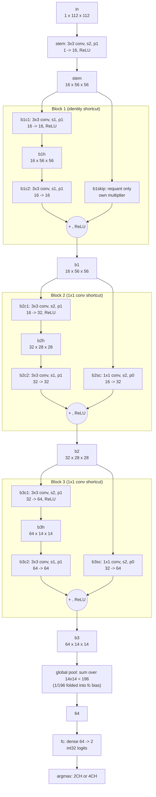

# ResNet-8 dataflow

Layer names match `CONVS` in `python/quantize.py`, `layers.txt` and the `.mem` file names. Tensor sizes are C x H x W (int8 activations). Conv and shortcut ops show kernel, stride and channels in -> out.

Both residual branches are requantized to the block output scale before the add. The shortcut is not clipped before the add, only the sum is clipped to 0..127.

## Per-layer sizes

| Layer | Kernel | Stride | Pad | In (C x H x W) | Out (C x H x W) | Weights | MACs |
|---|---|---|---|---|---|---|---|
| `stem` | 3x3 | 2 | 1 | 1 x 112 x 112 | 16 x 56 x 56 | 144 | 451,584 |
| `b1c1` | 3x3 | 1 | 1 | 16 x 56 x 56 | 16 x 56 x 56 | 2,304 | 7,225,344 |
| `b1c2` | 3x3 | 1 | 1 | 16 x 56 x 56 | 16 x 56 x 56 | 2,304 | 7,225,344 |
| `b2c1` | 3x3 | 2 | 1 | 16 x 56 x 56 | 32 x 28 x 28 | 4,608 | 3,612,672 |
| `b2c2` | 3x3 | 1 | 1 | 32 x 28 x 28 | 32 x 28 x 28 | 9,216 | 7,225,344 |
| `b2sc` | 1x1 | 2 | 0 | 16 x 56 x 56 | 32 x 28 x 28 | 512 | 401,408 |
| `b3c1` | 3x3 | 2 | 1 | 32 x 28 x 28 | 64 x 14 x 14 | 18,432 | 3,612,672 |
| `b3c2` | 3x3 | 1 | 1 | 64 x 14 x 14 | 64 x 14 x 14 | 36,864 | 7,225,344 |
| `b3sc` | 1x1 | 2 | 0 | 32 x 28 x 28 | 64 x 14 x 14 | 2,048 | 401,408 |
| `fc` | dense | - | - | 64 | 2 | 128 | 128 |
| **Total** | | | | | | **76,560** | **37,381,248** |

Biases (int32, one per output channel) are not counted in the weights column.
